<!-- README.md is generated from README.Rmd. Please edit that file -->

# shapvalues

<!-- badges: start -->

[](https://lifecycle.r-lib.org/articles/stages.html#experimental)
<!-- badges: end -->

`shapvalues` computes Shapley additive explanations (SHAP) for the
predictions of any supervised model through a single prediction
callback. It covers regression, binary and multiclass classification,
and right-censored survival analysis with time-dependent attributions.

The sampling (permutation) estimator is used: every coalition prediction
is issued in **one batched call**, and the marginal-contribution
reduction runs in parallel C++ via `RcppParallel`. Pairwise interaction
values are available. Alongside the familiar plots, the package ships
three opinionated multivariate views and one colour system with
selectable styles.

## Installation

``` r
# install.packages("pak")
pak::pak("ielbadisy/shapvalues")
```

## Quick start

``` r
library(shapvalues)

fit <- lm(mpg ~ ., data = mtcars)
sv  <- shapvalues(fit, X = mtcars[, -1], bg = mtcars[, -1], nsim = 100)
sv
#> <shapvalues>
#>   task     : regression
#>   method   : permutation (nsim = 100)
#>   explained: 32 obs x 10 features
#>   top features by mean|SHAP|:
#>     wt                   2.716
#>     disp                 1.448
#>     am                   1.222
#>     hp                   1.212
#>     qsec                 1.13
```

Local accuracy holds exactly for the Monte Carlo estimate:

``` r
max(abs(rowSums(sv$phi) + sv$baseline - sv$prediction[, 1]))
#> [1] 2.380318e-13
```

## A larger model for the gallery

The plots below use a random forest on the Boston housing data (506
tracts, 13 features).

``` r
data(Boston, package = "MASS")
rf  <- ranger::ranger(medv ~ ., data = Boston, num.trees = 400)
pf  <- function(object, newdata) predict(object, newdata)$predictions
svb <- shapvalues(rf, X = Boston[, -14], bg = Boston[, -14],
                  pred_fun = pf, nsim = 60, bg_size = 200)
```

## Standard plots

``` r
plot(svb, type = "beeswarm")
```

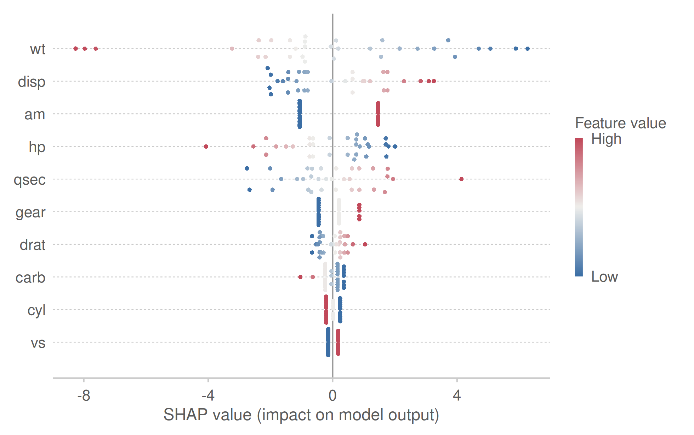

``` r
plot(svb, type = "importance")
```

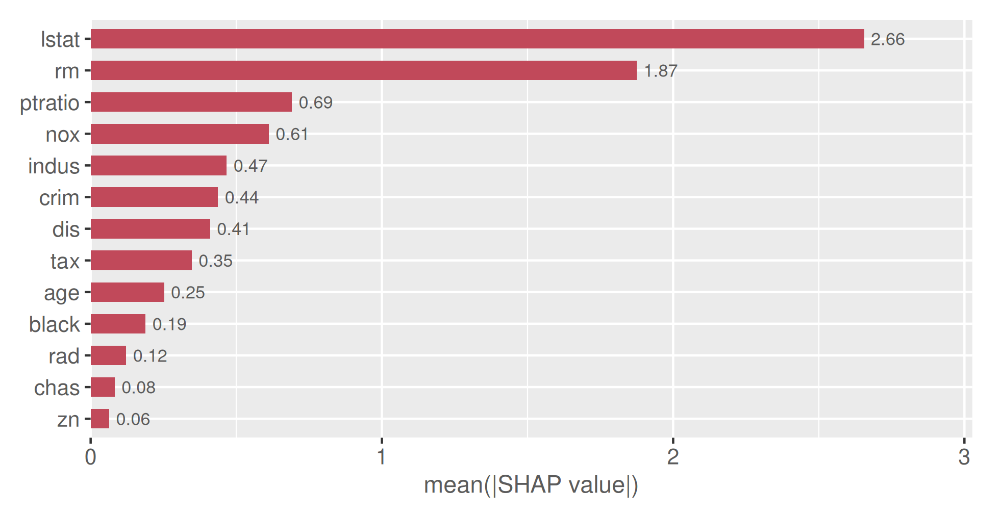

``` r
plot(svb, type = "waterfall", row = 1)
```

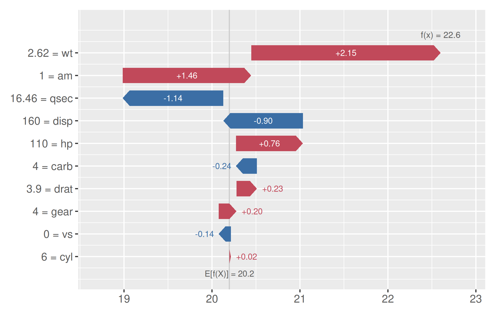

``` r
plot(svb, type = "dependence", feature = "rm", colour_by = "lstat")
```

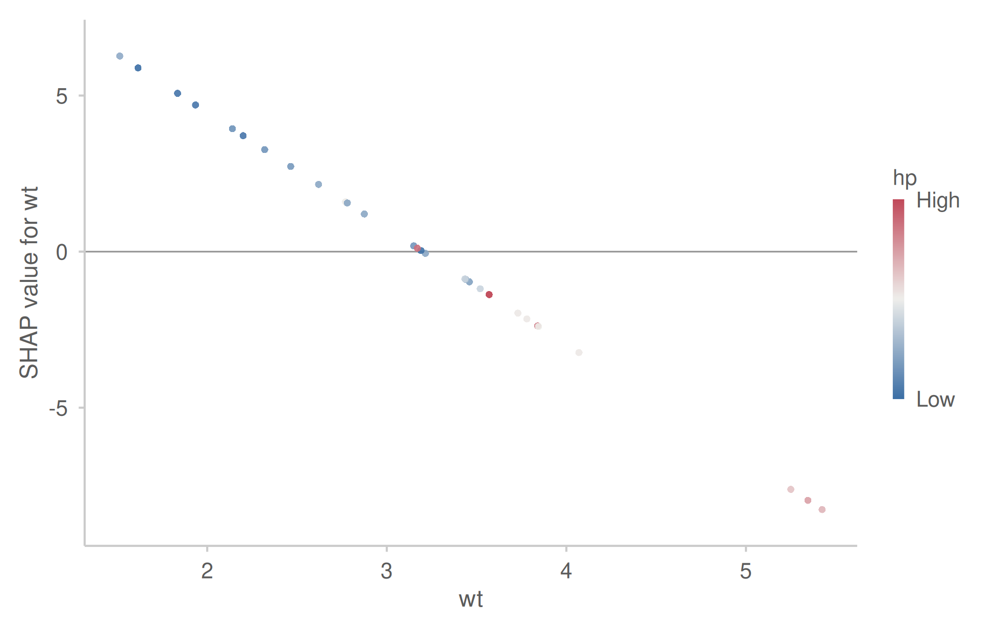

## Pairwise interaction values

``` r
svi <- shapvalues(lm(mpg ~ wt * hp + disp + drat + qsec, data = mtcars),
                  mtcars[, c("wt", "hp", "disp", "drat", "qsec")],
                  mtcars[, c("wt", "hp", "disp", "drat", "qsec")],
                  nsim = 120, interactions = TRUE)
plot(svi, type = "interaction", feature = "wt", interact = "hp")
```

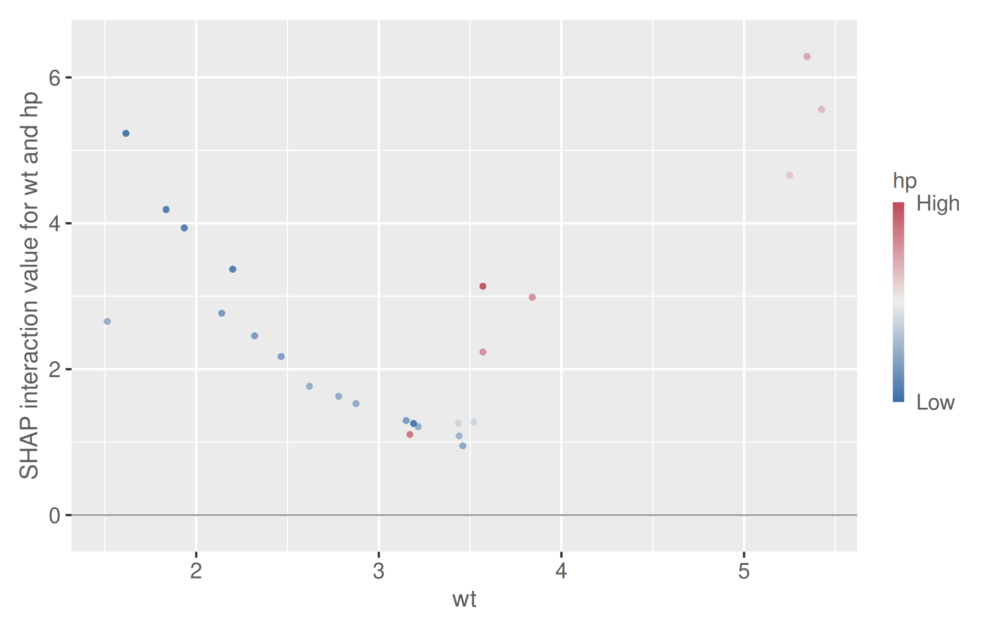

## Survival: SurvSHAP(t)

``` r
library(survival)
cox <- coxph(Surv(time, status) ~ age + karno + celltype, data = veteran, x = TRUE)
pf  <- function(object, newdata, times) {
  s <- summary(survfit(object, newdata = newdata), times = times, extend = TRUE)$surv
  t(matrix(s, nrow = length(times)))
}
svs <- shapvalues(cox, veteran[, c("age", "karno", "celltype")],
                  veteran[, c("age", "karno", "celltype")], pred_fun = pf,
                  times = c(30, 90, 180, 270, 365), task = "survival", nsim = 60)
plot(svs, type = "surv", row = 1)
```

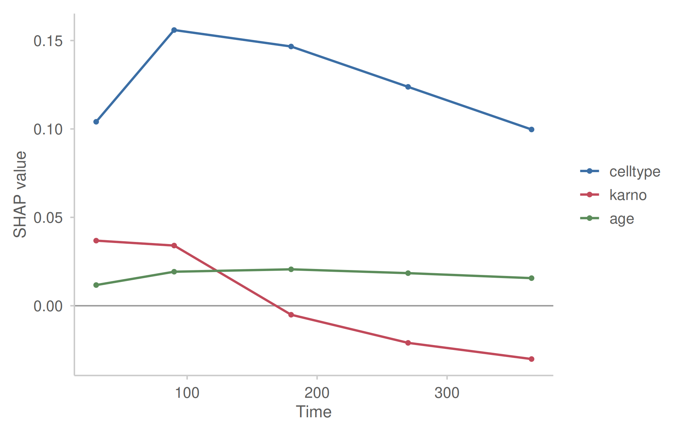

## Multivariate attribution views

These summarise the whole attribution vector of each observation rather
than marginalising one feature at a time.

**Compass** — each observation sits where its `|SHAP|` mass points;
distance from the centre is the explanation concentration `EC` in
`[0, 1]`.

``` r
plot(svb, type = "compass")
```

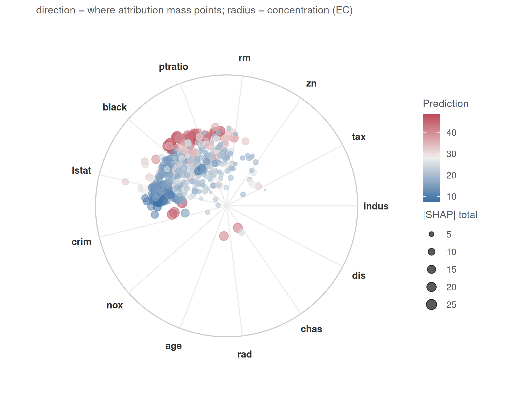

**Fingerprint** — a radial `|SHAP|` signature, here one per k-means
cluster of the SHAP profiles.

``` r
plot(svb, type = "fingerprint", k = 4)
```

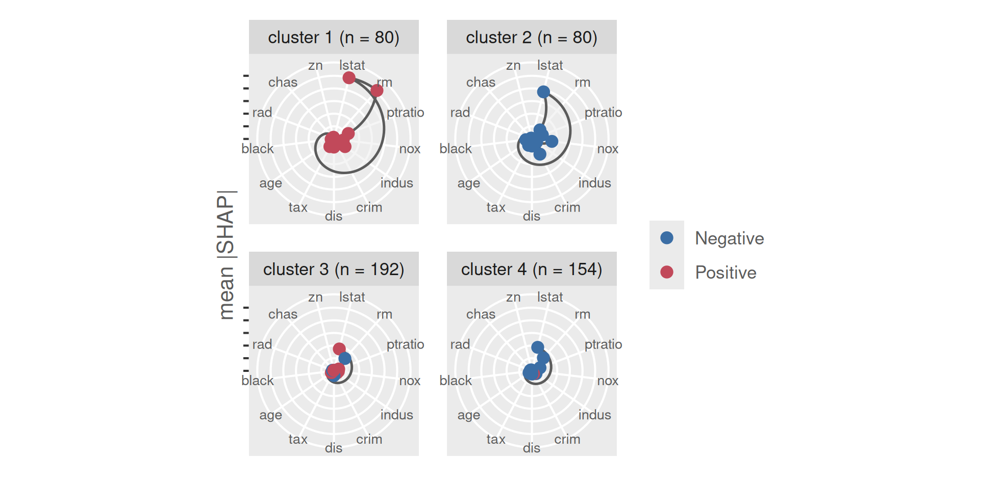

**Pathway** — an alluvial of the top-ranked contributors: node =
feature, flow width = observations, flow colour = the sign of the
dominant contribution.

``` r
plot(svb, type = "pathway", rank = 3)
```

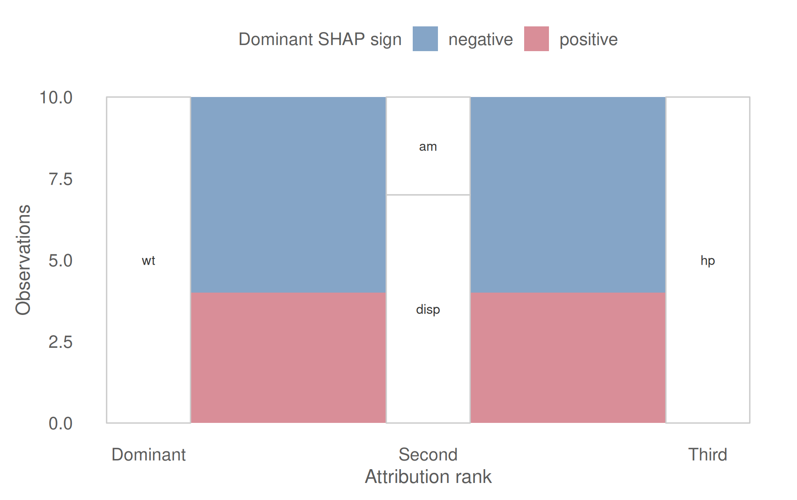

## One colour system, selectable styles

Every plot draws from `svstyle()`: the package’s own diverging pair, or
a `viridisLite` map.

``` r
plot(svb, type = "beeswarm", max_features = 6, title = "style = \"shapvalues\"")
plot(svb, type = "beeswarm", max_features = 6, title = "style = \"plasma\"", style = "plasma")
```

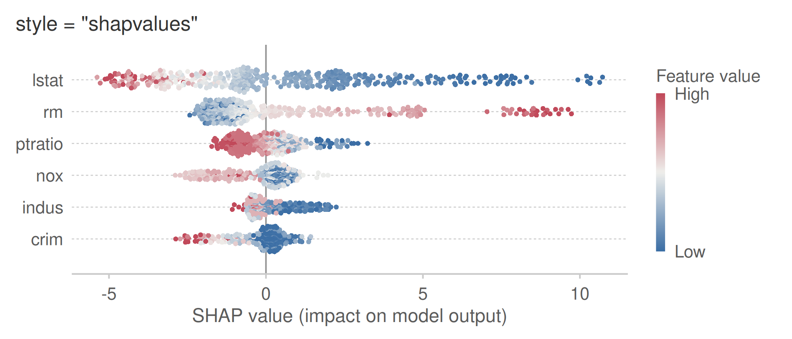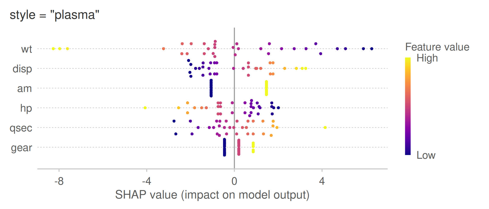

## Benchmark

`shapvalues` is the fastest model-agnostic SHAP estimator on CRAN in the
tests under `inst/benchmarks/` (3-6x faster than `fastshap`, 10-25x
faster than `kernelshap`, at accuracy on par with `fastshap`). Run
`Rscript inst/benchmarks/bench-shapvalues.R` to reproduce.
